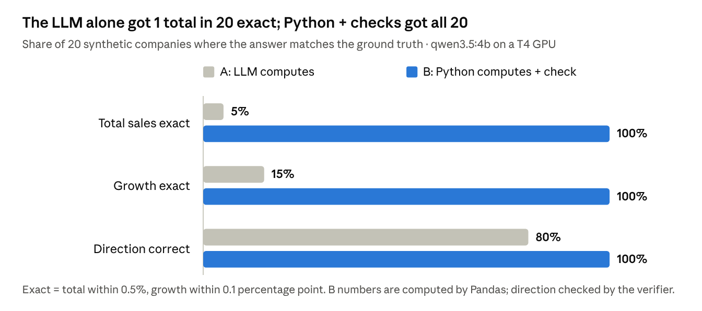
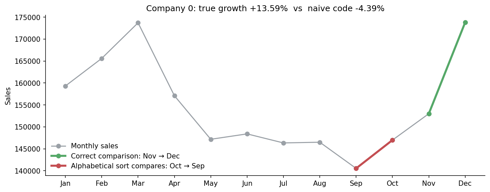
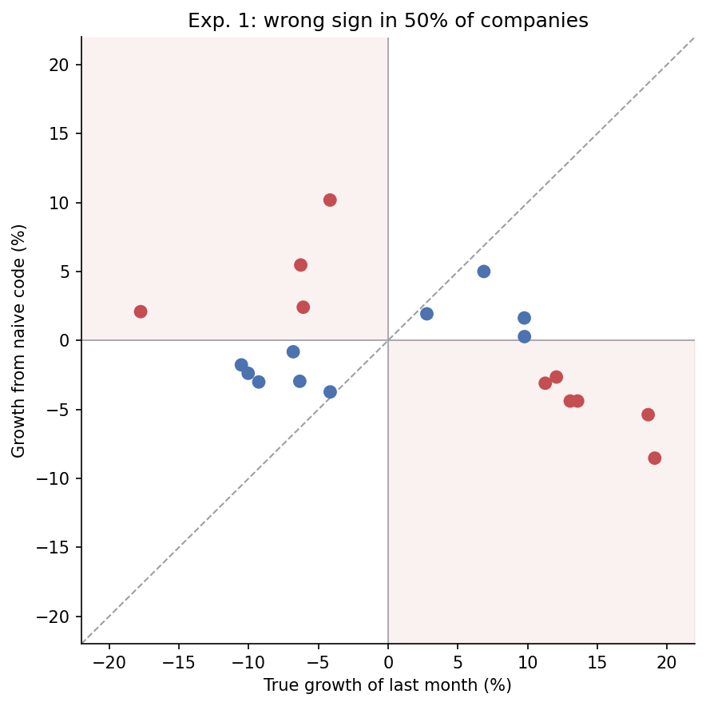
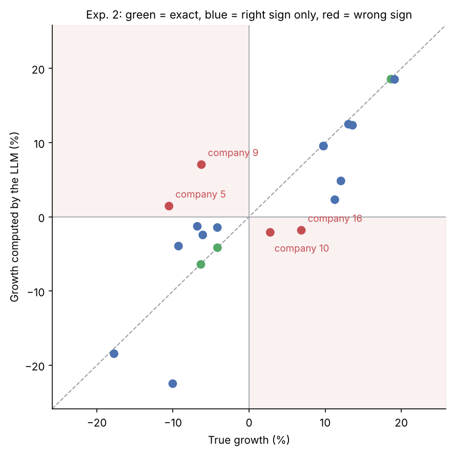
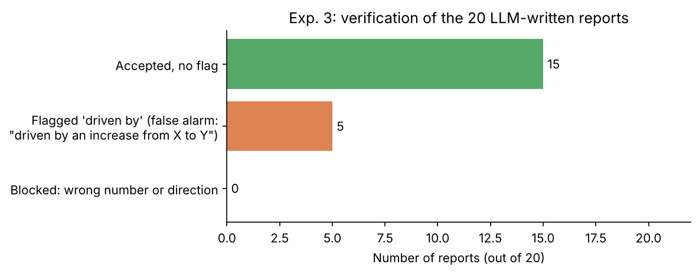

# Can a Small LLM Be Trusted With Your Numbers?

A small, reproducible experiment: a 4B local LLM (`qwen3.5:4b` via [Ollama](https://github.com/ollama/ollama-python)) analyses sales data with a **known ground truth**. We compare two designs for an "AI data analyst":

| | Who computes the numbers? | Who writes the text? |
|---|---|---|
| **A — LLM only** | the LLM, from the raw monthly table | the LLM |
| **B — Hybrid** | Python + Pandas | the LLM, from computed metrics; then code verifies the text |



| | |
|---|---|
|  |  |
|  |  |

## Key results (20 synthetic companies, 12 months each, seed 42, Kaggle T4 GPU)

| Check | A — LLM only | B — Hybrid |
|---|---|---|
| Total sales exact (within 0.5%) | 5% | 100% (computed by Pandas) |
| Monthly growth exact (within 0.1 pt) | 15% | 100% (computed by Pandas) |
| Direction correct (up / down) | 80% | 100% (no report blocked) |
| Reports flagged by the cause-keyword check | — | 5 of 20 (all false alarms on reading) |
| Typical time per answer (GPU) | ~1.2 s | ~2.1 s |

**Bonus finding — a classic Pandas bug.** Grouping by month *name* and calling `sort_index()` sorts months alphabetically, so the code compares *September vs October* instead of *December vs November*. On the same data this gave a wrong growth value in **100%** of cases and the wrong direction in **50%**. Fix: convert months to dates first (`pd.to_datetime`, then `dt.to_period("M")`).

## What the notebook does

1. Installs Ollama and pulls the model (Linux / Kaggle / Colab).
2. Generates 20 synthetic companies with a known answer (half up, half down in the last month).
3. **Experiment 1:** the month-sorting pitfall (no LLM).
4. **Experiment 2:** the LLM computes totals and growth from the raw table (JSON output).
5. **Experiment 3:** Python computes, the LLM explains, a verifier checks percentages, direction and cause words.
6. Saves all results as CSV + `summary.json` + a chart in `outputs/`.

## Run it

- **Kaggle (easiest):** open the notebook, set *Internet → On* (GPU T4 recommended), *Run All*. Under 5 min with the T4 GPU (much slower on CPU).
- **Locally:**
  ```bash
  pip install -r requirements.txt
  # install Ollama from https://ollama.com, then:
  ollama pull qwen3.5:4b
  jupyter notebook llm_numbers_experiment.ipynb
  ```

Change the model, number of scenarios or tolerances in the first cell.

## Limits

- Synthetic data; real data is noisier.
- One model at temperature 0; 20 scenarios is a small sample.
- The verifier checks percentages and direction only (not dollar amounts); cause detection is a keyword list and gave 5 false alarms out of 5 ("driven by an increase from X to Y").
- Figures 3, 7 and 8 in `outputs/figures/` were re-drawn from the same CSVs with clearer labels.

## Links

- Article (Medium): *link to add after publication*
- Kaggle notebook: https://www.kaggle.com/code/bilelcharfi/llm-numbers-experiment

## Author

Bilel Charfi — applied mathematics, ESPRIT (Tunis). [Medium](https://medium.com/@charfibilel) · [GitHub](https://github.com/CharfiBilel)

License: MIT
